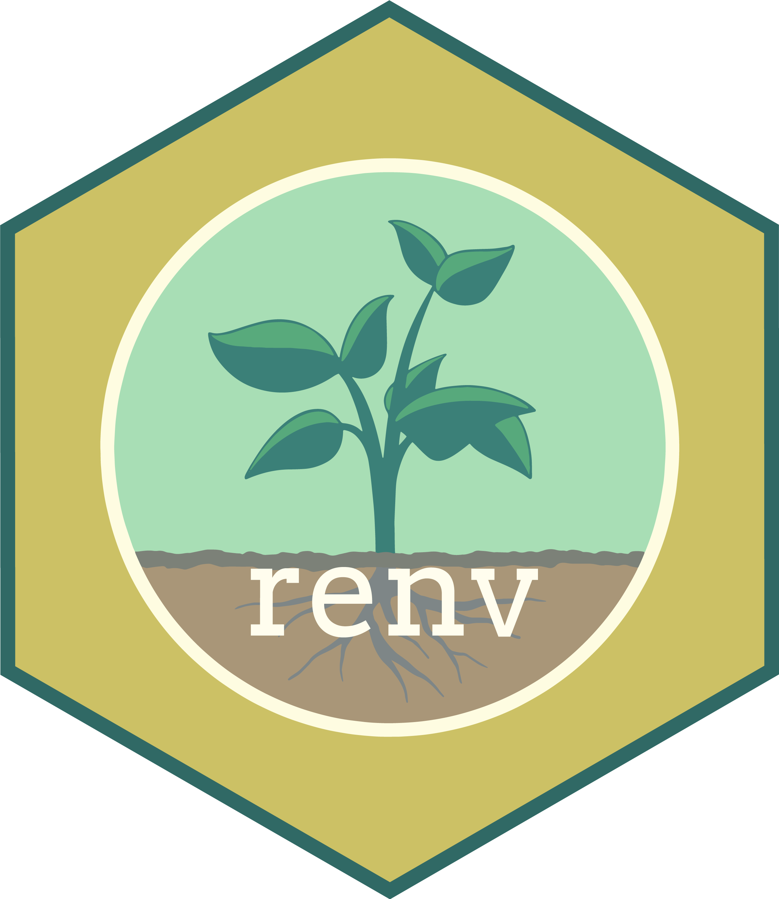
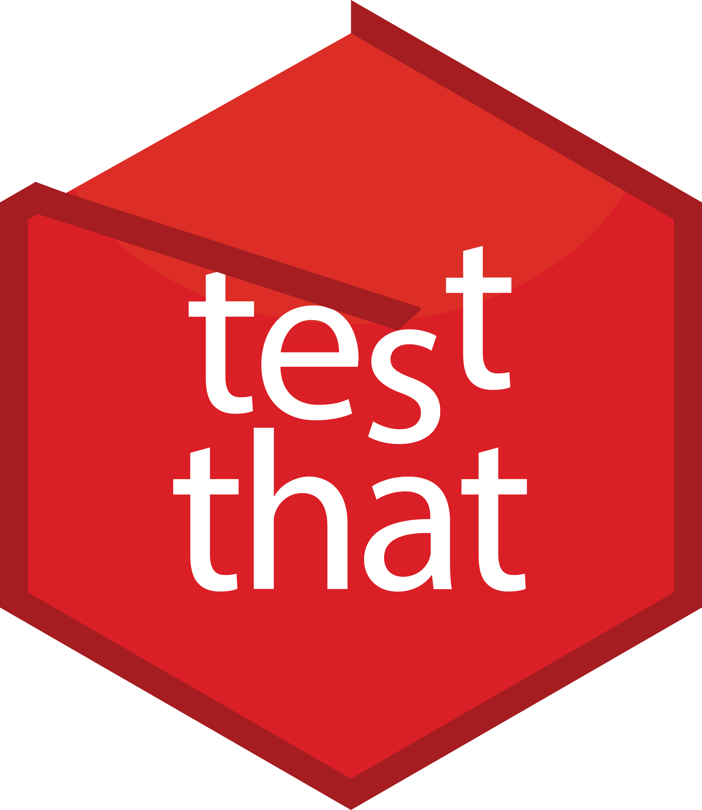

<p>




</p>

# Project skeleton

<!-- PLACEHOLDER: replace <DOI> (twice) with the concept DOI after your first Zenodo release, then delete this comment. -->
[](https://doi.org/<DOI>)

**How to cite:** see [CITATION.cff](CITATION.cff).

A minimal, reproducible starting point for an R research project: a simple
folder layout, a curated `.gitignore`, pinned packages with renv, data checks
with testthat, and a place for external data with pins. Download
it, delete what you do not need, and start working.

## Getting started

1. Download this repository as a zip file, unzip it and rename the folder to
   your project name. You start with no git history; run `git init` when you
   are ready (or forced) to use git.
2. Open `project-skeleton.Rproj` in RStudio (rename it to match your project).
3. Put raw data in `data/raw/` and edit the numbered scripts in `scripts/`.
4. Replace the placeholders in `CITATION.cff` and `LICENSE`.
5. Run `renv::init()` at the end of the project, before you share the code
   (see `PROJECT_STRUCTURE.md`).
6. Read `PROJECT_STRUCTURE.md`, then **delete it**. Rewrite this `README.md` to
   describe your own project.

## Folder structure

```
.
├── CITATION.cff
├── LICENSE
├── PROJECT_STRUCTURE.md
├── project-skeleton.Rproj
├── R
│   ├── README.md
│   └── check_data.R
├── README.md
├── data
│   ├── README.md
│   ├── processed
│   │   └── README.md
│   └── raw
│       └── README.md
├── docs
│   ├── README.md
│   └── img
│       ├── README.md
│       └── (logos)
├── outputs
│   └── README.md
├── scripts
│   ├── 1_download.R
│   ├── 2_wrangle.R
│   ├── 3_analyse.R
│   └── README.md
└── tests
    ├── README.md
    ├── testthat
    │   ├── README.md
    │   ├── helper-functions.R
    │   └── test-check_data.R
    └── testthat.R
```

Details, rules and recipes are in [PROJECT_STRUCTURE.md](PROJECT_STRUCTURE.md): documentation of this skeleton, to read and then delete.

## Optional add-ons

Optional extras live in separate branches: `zenodo`, `website` and `githooks`.
You will not see them unless you look for them: `PROJECT_STRUCTURE.md`
describes each one and links to it.

## Archiving with Zenodo

Zenodo stores a frozen copy of a GitHub release and gives it a citable, permanent DOI.
Do it when you submit the paper: fill in `CITATION.cff`, enable the repo on Zenodo, create a release.
Steps and checklist: "Archiving with Zenodo" in [PROJECT_STRUCTURE.md](PROJECT_STRUCTURE.md).
